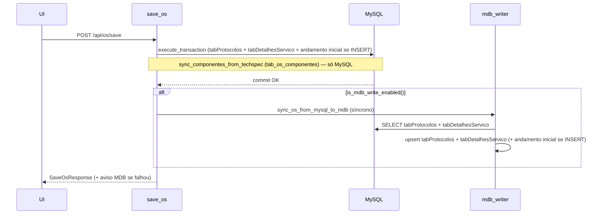

# Relatório de Auditoria — Sincronização MySQL para MDB

**Data:** 2026-06-09  
**Escopo:** Auditoria somente leitura — código, configuração e logs. Nenhuma alteração aplicada.  
**Problema reportado:** Andamentos do SAGRA Web não chegam ao MDB; alterações de OS devem replicar apenas campos existentes no Access.

---

## 1. Veredito

| Pergunta | Resposta |
|----------|----------|
| **MDB está habilitado?** | **Depende do ambiente.** Dev local: **sim** (`MYSQL_ONLY=false` → `is_mdb_write_enabled()=True`). Produção (template deploy): **não** (`MYSQL_ONLY=true` → `is_mdb_write_enabled()=False`). |
| **Fluxo está sendo chamado?** | **Sim no código**, quando MDB write está habilitado. Rotas de andamento chamam `_dispatch_mdb_sync` → `sync_andamento_from_mysql_to_mdb`. Save OS chama `sync_os_from_mysql_to_mdb` de forma **síncrona** após commit MySQL. |
| **Onde está falhando?** | **Causa primária (produção):** dual-write desligado por configuração. **Causas secundárias (quando MDB habilitado):** (a) andamento exige OS pré-existente em `tabProtocolos` do MDB; (b) erros assíncronos de andamento ficam só no log, sem aviso na UI; (c) homologação recente usou MDB de cópia (`BackupMySQL`) desatualizado em relação ao MySQL. |

**Resumo executivo:** O código de sincronização existe e funciona parcialmente (logs confirmam replicação bem-sucedida para OS 812, 846 e 568 em dev). Em produção, **nenhuma gravação MDB ocorre** porque `MYSQL_ONLY=true`. Mesmo com MDB ligado, andamentos de OSs que existem só no MySQL (ou só na cópia desatualizada) falham com `Protocolo N/AAAA ausente em tabProtocolos do MDB`.

---

## 2. Configuração

### 2.1 Arquivos analisados

| Arquivo | Valores relevantes |
|---------|-------------------|
| `config/.env` (dev local) | `ENV=development`, `MYSQL_ONLY=false`, `SYNC_ANDAMENTOS_ENABLED=false`, retry MDB 5× / 2s |
| `config/config.json` | MDB produção: `I:\...\BaseDeDados - SAGRA2\Sagra Base - OS Atual.mdb` e `...\Papelaria Atual.mdb` |
| `config/.env.production.example` | `ENV=production`, `MYSQL_ONLY=true`, `PORT=8010` |
| `deploy/templates/config/.env` | `MYSQL_ONLY=true` |
| `deploy/release/config/.env.example` | `MYSQL_ONLY=true` |
| `config_manager.py` DEFAULT_CONFIG | `mysql_only: True` (default se `.env` ausente) |

### 2.2 Flags e funções

```python
# config_manager.py
def is_mysql_only(self) -> bool:
    return _parse_bool(self.get("mysql_only"), default=True)

def is_mdb_write_enabled(self) -> bool:
    return not self.is_mysql_only()

def is_sync_andamentos_enabled(self) -> bool:
    if self.is_mysql_only():
        return False
    return _parse_bool(self.get("sync_andamentos_enabled"), default=False)
```

| Flag / função | Dev local (verificado via Python) | Produção (template) |
|---------------|-----------------------------------|---------------------|
| `ENV` | `development` | `production` |
| `MYSQL_ONLY` | `false` | `true` |
| `SYNC_ANDAMENTOS_ENABLED` | `false` | `false` |
| `is_mdb_write_enabled()` | **`True`** | **`False`** |
| Rotas `/api/sync/*` | Desabilitadas | Desabilitadas |

**Nota:** `SYNC_ANDAMENTOS_ENABLED` controla o motor legado `sync_andamentos_v2` via API — **não** o dual-write em tempo real do `mdb_writer.py`.

### 2.3 Caminhos MDB

| Tipo | `config.json` atual | Logs de homologação (2026-06-08) |
|------|---------------------|----------------------------------|
| OS Atual (<5000) | `...\BaseDeDados - SAGRA2\Sagra Base - OS Atual.mdb` | `...\BackupMySQL\Sagra Base - OS Atual.mdb` |
| Papelaria (≥5000) | `...\BaseDeDados - SAGRA2\Sagra Base - Papelaria Atual.mdb` | `...\BackupMySQL\Sagra Base - Papelaria Atual.mdb` |

Os logs indicam que, durante testes recentes, o `config.json` apontava para cópias em `BackupMySQL` (conforme `docs/ROTEIRO_HOMOLOGACAO_SUB_OS_MDB.md`). O arquivo atual no repositório voltou aos caminhos de produção.

### 2.4 Startup (log)

```
Startup: ENV=development | API=http://127.0.0.1:8001/api | MYSQL_ONLY=False | SYNC=False
Rotas /api/sync/* desabilitadas — sync_andamentos executado por outro sistema (MYSQL_ONLY)
```

A mensagem sobre `MYSQL_ONLY` nas rotas sync é **enganosa** — na verdade desliga quando `SYNC_ANDAMENTOS_ENABLED=false`, não quando `MYSQL_ONLY=true`.

### 2.5 Produção com MDB desligado?

**Sim, por configuração intencional do template.** Todos os artefatos de deploy mantêm `MYSQL_ONLY=true`. Enquanto isso não for alterado explicitamente no servidor `10.1.1.73`, **andamentos e alterações de OS permanecem somente no MySQL**, sem exceção.

---

## 3. Fluxo OS → MDB

### 3.1 Endpoint

`POST /api/os/save` → `save_os()` em `routers/os_routes.py`.

### 3.2 Sequência



### 3.3 Pontos de chamada MDB

| Operação | Função | `sync_andamentos` | Modo |
|----------|--------|-------------------|------|
| INSERT OS | `sync_os_from_mysql_to_mdb` | `True` + `cod_statuses=[NNNNNAAAA-01]` | Síncrono |
| UPDATE OS | `sync_os_from_mysql_to_mdb` | `False` | Síncrono |
| Duplicar OS | `sync_os_from_mysql_to_mdb` | `True` + andamento inicial | Síncrono |

### 3.4 Campos enviados ao MDB

**tabProtocolos** (`prepare_os_protocol_params` + `_write_protocolo`):

`CodigoRequisic`, `CategoriaLink`, `NomeUsuario`, `Titular`, `OrgInteressado`, `SiglaOrgao`, `GabSalaUsuario`, `Andar`, `Localizacao`, `RamalUsuario`, `DataEntrada`, `ProcessoSolicit`, `CSnro`, `EntregPrazoLink`, `EntregData`, `ContatoTrab`, `CotaRepro` ou `CotaCartao` (conforme `nro < 5000`).

Colunas opcionais no INSERT (somente se existirem no MDB): `RetiradaNome`, `Funcionario`, `DataRecebimento`, `PontoEntrega`, `SetorEntrega`, `CancelamentoMotivo`, `CancelamentoSetor`.

**tabDetalhesServico** (`prepare_os_detalhes_params` + `_write_detalhes`):

Campos de `_DETALHES_WRITE_FIELDS` **filtrados** por `_mdb_table_columns()` — só grava colunas que existem no `.mdb` alvo.

### 3.5 Campos ignorados (correto)

| Origem (MySQL / request) | Destino MDB | Observação |
|--------------------------|-------------|------------|
| `TechSpec` / `techspec_json` | — | Gravado em `tab_os_componentes` via `sync_componentes_from_techspec` — **não vai ao MDB** |
| `Calculos` (payload) | Parcial | Derivados para `CalcPgs*`, `CalcQtdCores*`, `CalcCor*` em `tabDetalhesServico` |
| `PontoUsuario` | — | Usado para log/andamento, não é coluna de protocolo no MDB |
| `CodUsuarioLink` | — | Presente no MySQL/duplicate, **ausente** do mapeamento MDB |
| `tab_os_sub_os`, `tab_os_componentes` | — | Tabelas exclusivas MySQL |
| Componentes livres, Sub OS | — | Sem tabela equivalente no Access |

### 3.6 Pontos de falha

1. **`is_mdb_write_enabled()=False`** — sync ignorado silenciosamente (produção).
2. **Campo inexistente no MDB** — log histórico: `Funcionario` em INSERT (jun/2026); código atual trata como opcional, mas MDBs antigos podem falhar se lógica regressar.
3. **Lookup tables ausentes** — `tabProdutos` não encontrada em alguns MDBs de teste (warning, não aborta).
4. **UPDATE não re-sincroniza andamentos** — correto por design; andamentos têm fluxo próprio.
5. **Falha síncrona no save** — usuário recebe aviso via `format_mdb_failure_message()` anexado à mensagem de sucesso.

---

## 4. Fluxo Andamento → MDB

### 4.1 Andamento normal (OS principal)

**Endpoint:** `POST /api/os/{ano}/{id}/history` → `add_os_history()`.

| Etapa | Onde | Detalhe |
|-------|------|---------|
| 1 | MySQL | `UPDATE tabAndamento SET UltimoStatus=0` nos registros atuais |
| 2 | MySQL | `INSERT tabAndamento` com `UltimoStatus=1`, `CodStatus=NNNNNAAAA-SS` |
| 3 | MySQL | Se há componentes ativos: `propagate_main_os_andamento_to_sub_os` → `tab_os_sub_os_andamento` (**sem espelho em tabAndamento, sem MDB**) |
| 4 | MDB | `_dispatch_mdb_sync("history_add", sync_andamento_from_mysql_to_mdb)` — **assíncrono** |

**CodStatus:** formato `f"{id:05d}{ano}-{seq:02d}"` — compatível com padrão legado Access.

**Campos replicados** (`_upsert_andamento_row`): `CodStatus`, `NroProtocoloLink`, `AnoProtocoloLink`, `SituacaoLink`, `SetorLink`, `Data`, `UltimoStatus`, `Observaçao`, `Ponto`.

**Pré-condição crítica:** `_ensure_protocolo_in_mdb()` — se a OS não existir em `tabProtocolos` do MDB, a replicação **aborta** com `ValueError` (não retentável).

**Gate `confirm_main_os_target`:** Bloqueia a operação (HTTP 403) se a OS tem componentes/Sub OS e o frontend não confirma destino principal. **Não interfere no payload MDB** após confirmação.

### 4.2 Andamento Sub OS (espelho)

**Endpoint:** `POST /api/os/{ano}/{id}/sub-os/{sub_os_id}/history` → `add_sub_os_history()`.

| Destino | Tabela | UltimoStatus | Sync MDB |
|---------|--------|--------------|----------|
| Andamento próprio Sub OS | `tab_os_sub_os_andamento` | 1 | **Não** |
| Espelho histórico principal | `tabAndamento` | **0** | **Sim** (`sub_os_history_mirror`) |

O espelho usa `format_mirror_obs()` no campo `Observaçao` e chama `sync_andamento_from_mysql_to_mdb(mirror_cod_status, nro, ano)` via fila assíncrona.

### 4.3 Propagação OS principal → Sub OS (herdado)

`propagate_main_os_andamento_to_sub_os()`:

- Grava em `tab_os_sub_os_andamento` com `herdado_da_os_principal=1`, `cod_status_espelho=NULL`.
- **Não cria registro em `tabAndamento`.**
- **Não chama MDB.**

Regra atendida: andamentos herdados **não** geram múltiplos registros no MDB.

### 4.4 Edição / exclusão

| Operação | Endpoint | MySQL | MDB | `_fix_ultimo_status_mdb` |
|----------|----------|-------|-----|--------------------------|
| Editar andamento principal | `PUT /api/os/{ano}/{id}/history` | UPDATE `tabAndamento` | `sync_andamento_from_mysql_to_mdb` (async) | Não (UltimoStatus inalterado) |
| Excluir andamento principal | `DELETE .../history/{cod}` | DELETE + `recalc_ultimo_status_operacional` | `sync_andamento_delete_to_mdb` (async) | **Sim** — exclui espelhos Sub OS do cálculo |
| Excluir espelho Sub OS | `DELETE .../sub-os/.../history/{id}` | DELETE espelho `UltimoStatus=0` | `sync_andamento_delete_to_mdb` (async) | **Sim** |
| Excluir herdado Sub OS | idem | DELETE só `tab_os_sub_os_andamento` | **Não** | — |
| Editar andamento Sub OS | `PUT ...` | **405 bloqueado** | — | — |
| Replicar para vínculos | `POST .../history/replicate` | INSERT em cada OS alvo | sync de cada `cod_status` (async) | — |

### 4.5 Collation

Correção aplicada em `andamento_operacional.py` (`NOT EXISTS` + `COLLATE utf8mb4_general_ci`) para recálculo MySQL de `UltimoStatus`. **Fluxo MDB não usa collation** — `_fix_ultimo_status_mdb` consulta espelhos via Python (`get_mirror_cod_statuses_for_os`) e SQL Access.

Impacto: exclusão de andamento no MySQL deixou de falhar por collation; **não bloqueia** sync MDB.

### 4.6 Pontos de falha (andamento)

1. **MDB desligado** (`MYSQL_ONLY=true`) — `_dispatch_mdb_sync` retorna imediatamente.
2. **OS ausente no MDB** — erro mais frequente nos logs de homologação (OS 5943–5946 Papelaria).
3. **Erros assíncronos invisíveis na UI** — `history_add` retorna `200 OK` antes do worker processar; falhas aparecem só em `sagra_api.log` (`Falha no sync MDB assíncrono`).
4. **Diferença save vs history** — save OS avisa usuário; andamento **não**.

---

## 5. MDB writer / fila

### 5.1 Módulo

`app/backend/routers/mdb_writer.py` — fonte da verdade MySQL → upsert Access com retry.

### 5.2 Fila assíncrona

| Parâmetro | Valor |
|-----------|-------|
| Implementação | `Queue(maxsize=256)` + thread daemon `mdb-sync-worker` |
| Ativação | `_ensure_mdb_sync_worker()` no primeiro `_dispatch_mdb_sync` |
| Config `mdb_sync_async_enabled` | Default `True` (não presente em `.env` — usa default) |
| Fila cheia | Fallback síncrono + warning no log |
| Erro no worker | `logger.error("Falha no sync MDB assíncrono (%s): %s")` — **sem propagação à UI** |

### 5.3 Retry

- Até 5 tentativas, backoff `2s × tentativa`.
- Retentável: lock, arquivo em uso, busy, códigos ODBC `-1102`, `3045`, etc.
- **Não retentável:** `Protocolo ausente`, campo desconhecido, tabela inexistente.

### 5.4 Logs — erros encontrados

| Tipo | Exemplo no log | Frequência |
|------|----------------|------------|
| Protocolo ausente no MDB | `Protocolo 5943/2026 ausente em tabProtocolos do MDB ...BackupMySQL...` | Alta (homologação Papelaria) |
| Andamento replicado OK | `Andamento 008122026-09 replicado MySQL→MDB (OS 812/2026)` | Confirmado |
| Exclusão MDB sem registro | `Andamento ... não encontrado no MDB — exclusão ignorada` | Esperado quando insert falhou antes |
| Campo desconhecido (legado) | `nome de campo desconhecido: 'Funcionario'` | Jun/2026 (OS 989) |
| Tabela lookup ausente | `tabProdutos` não localizada | Warnings em MDBs de teste |
| Collation MySQL | `Illegal mix of collations` | Afeta exclusão MySQL (corrigido); pendências email UNION |
| Lock MDB | — | **Não observado** nos logs recentes |
| `MYSQL_ONLY` / write disabled | Startup `MYSQL_ONLY=False` em dev | Produção: template `true` |
| Fila cheia | — | **Não observado** |

### 5.5 Dev vs produção

| Aspecto | Dev local | Produção (template) |
|---------|-----------|---------------------|
| MDB write | Habilitado | **Desabilitado** |
| Caminho MDB | Produção no `config.json` atual; logs usaram `BackupMySQL` | Produção `BaseDeDados - SAGRA2` |
| Erros visíveis ao usuário (andamento) | Não | N/A (sync nem roda) |
| Porta API | 8001 | 8010 |

---

## 6. Compatibilidade de campos

### 6.1 tabProtocolos

| Campo MySQL | Campo MDB | Existe no MDB? | Deve sincronizar? | Observação |
|-------------|-----------|----------------|-------------------|------------|
| `NroProtocolo` | `NroProtocolo` | Sim (PK) | Sim | Chave |
| `AnoProtocolo` | `AnoProtocolo` | Sim (PK) | Sim | Chave |
| `CodigoRequisic` | `CodigoRequisic` | Sim | Sim | |
| `CategoriaLink` | `CategoriaLink` | Sim | Sim | Lookup auto-insert |
| `NomeUsuario` | `NomeUsuario` | Sim | Sim | |
| `Titular` | `Titular` | Sim | Sim | |
| `OrgInteressado` | `OrgInteressado` | Sim | Sim | |
| `SiglaOrgao` | `SiglaOrgao` | Sim | Sim | |
| `GabSalaUsuario` | `GabSalaUsuario` | Sim | Sim | |
| `Andar` | `Andar` | Sim | Sim | Memo |
| `Localizacao` | `Localizacao` | Sim | Sim | |
| `RamalUsuario` | `RamalUsuario` | Sim | Sim | |
| `DataEntrada` | `DataEntrada` | Sim | Sim | |
| `ProcessoSolicit` | `ProcessoSolicit` | Sim | Sim | |
| `CSnro` | `CSnro` | Sim | Sim | |
| `EntregPrazoLink` | `EntregPrazoLink` | Sim | Sim | |
| `EntregData` | `EntregData` | Sim | Sim | |
| `ContatoTrab` | `ContatoTrab` | Sim | Sim | Memo |
| `CotaRepro` / `CotaCartao` | Dinâmico | Sim (um dos dois) | Sim | `cota_protocolo_column(nro)` |
| `CodUsuarioLink` | — | Não mapeado | **Não** | Ignorado pelo `mdb_writer` |
| `RetiradaNome` | `RetiradaNome` | Opcional | Se existir | INSERT only, NULL |
| `Funcionario` | `Funcionario` | Opcional | Se existir | Erro histórico em MDB sem coluna |
| `DataRecebimento` | `DataRecebimento` | Opcional | Se existir | |
| `PontoEntrega` | `PontoEntrega` | Opcional | Se existir | |
| `SetorEntrega` | `SetorEntrega` | Opcional | Se existir | |
| `CancelamentoMotivo` | `CancelamentoMotivo` | Opcional | Se existir | |
| `CancelamentoSetor` | `CancelamentoSetor` | Opcional | Se existir | |

### 6.2 tabDetalhesServico

| Campo MySQL | Campo MDB | Existe no MDB? | Deve sincronizar? | Observação |
|-------------|-----------|----------------|-------------------|------------|
| `NroProtocoloLinkDet` | `NroProtocoloLinkDet` | Sim (PK) | Sim | |
| `AnoProtocoloLinkDet` | `AnoProtocoloLinkDet` | Sim (PK) | Sim | |
| `Titulo` | `Titulo` | Sim | Sim | |
| `TipoPublicacaoLink` | `TipoPublicacaoLink` | Sim | Sim | |
| `FormatoLink` | `FormatoLink` | Sim | Sim | |
| `MaquinaLink` | `MaquinaLink` | Sim | Sim | |
| `Tiragem` | `Tiragem` | Sim | Sim | |
| `Pags` | `Pags` | Sim | Sim | |
| `FrenteVerso` | `FrenteVerso` | Sim | Sim | Bool |
| `ModelosArq` | `ModelosArq` | Sim | Sim | |
| `PapelLink` | `PapelLink` | Sim | Sim | |
| `PapelDescricao` | `PapelDescricao` | Sim | Sim | |
| `Cores` | `Cores` | Sim | Sim | |
| `CoresDescricao` | `CoresDescricao` | Sim | Sim | |
| `DescAcabamento` | `DescAcabamento` | Sim | Sim | |
| `Observ` | `Observ` | Sim | Sim | |
| `TiragemSolicitada` | `TiragemSolicitada` | Sim | Sim | |
| `CotaTotal` | `CotaTotal` | Sim | Sim | |
| `MaterialFornecido` | `MaterialFornecido` | Sim | Sim | Bool |
| `Fotolito` | `Fotolito` | Sim | Sim | Bool |
| `ModeloDobra` | `ModeloDobra` | Sim | Sim | Bool |
| `ProvaImpressa` | `ProvaImpressa` | Sim | Sim | Bool |
| `InsumosFornecidos` | `InsumosFornecidos` | Sim | Sim | |
| `ElemGrafBrasao` | `ElemGrafBrasao` | Sim | Sim | Bool |
| `ElemGrafTimbre` | `ElemGrafTimbre` | Sim | Sim | Bool |
| `ElemGrafArteGab` | `ElemGrafArteGab` | Sim | Sim | Bool |
| `ElemGrafAssinatura` | `ElemGrafAssinatura` | Sim | Sim | Bool |
| `CalcPgs1..3` | `CalcPgs1..3` | Se existir | Sim | Filtro `_mdb_table_columns` |
| `CalcQtdCores1..3` | `CalcQtdCores1..3` | Se existir | Sim | |
| `CalcCor1..3` | `CalcCor1..3` | Se existir | Sim | |
| `techspec_json` (componentes) | — | **Não** | **Não** | Tabela `tab_os_componentes` |

### 6.3 tabAndamento

| Campo MySQL | Campo MDB | Existe no MDB? | Deve sincronizar? | Observação |
|-------------|-----------|----------------|-------------------|------------|
| `CodStatus` | `CodStatus` | Sim (PK) | Sim | Formato `NNNNNAAAA-SS` |
| `NroProtocoloLink` | `NroProtocoloLink` | Sim (FK) | Sim | Obrigatório no MDB |
| `AnoProtocoloLink` | `AnoProtocoloLink` | Sim (FK) | Sim | |
| `SituacaoLink` | `SituacaoLink` | Sim | Sim | |
| `SetorLink` | `SetorLink` | Sim | Sim | |
| `Data` | `Data` | Sim | Sim | `to_mdb_datetime` |
| `UltimoStatus` | `UltimoStatus` | Sim | Sim | Bool; espelhos Sub OS = 0 |
| `Observaçao` | `Observaçao` | Sim | Sim | Memo CRLF |
| `Ponto` | `Ponto` | Sim | Sim | |
| `source_type`, `herdado_da_os_principal` | — | **Não** | **Não** | Só em `tab_os_sub_os_andamento` |
| `cod_status_espelho` | — | **Não** | **Não** | Metadado Sub OS |

---

## 7. Impacto das novas features

| Feature | Interfere no MDB? | Avaliação |
|---------|-------------------|-----------|
| **Componentes livres** (`tab_os_componentes`, `TechSpec`) | Não diretamente | Dados ficam só no MySQL; `sync_componentes_from_techspec` roda dentro da transação save, sem chamada MDB |
| **`techspec_json`** | Não | Derivados numéricos vão para `Calc*` em detalhes se existirem no MDB |
| **Sub OS** (`tab_os_sub_os`) | Não | Sem equivalente Access |
| **Espelhos Sub OS** | **Sim** | Espelho em `tabAndamento` com `UltimoStatus=0` → `sync_andamento_from_mysql_to_mdb` |
| **Propagação andamento principal → Sub OS** | Não no MDB | Só `tab_os_sub_os_andamento`; **correto** — 1 registro MDB por andamento principal |
| **`confirm_main_os_target`** | Não no payload | Gate de autorização; após confirmação, fluxo MDB idêntico |
| **Alteração `UltimoStatus`** | Sim | `_upsert_andamento_row` zera outros quando `UltimoStatus=1`; `_fix_ultimo_status_mdb` na exclusão exclui espelhos do TOP 1 |
| **Congelamento Sub OS** | Indireto | Bloqueia novos andamentos Sub OS; não altera sync de andamentos já gravados |

**Risco residual:** Se andamento principal for adicionado com componentes ativos, a propagação cria registros herdados na Sub OS **sem** duplicar no MDB — comportamento esperado. Espelhos manuais de Sub OS entram no histórico MDB com `UltimoStatus=0` e não devem virar status operacional (`_fix_ultimo_status_mdb` os ignora).

---

## 8. Causa provável

### Por que os andamentos não estão indo para o MDB

**Hipótese 1 — Produção (mais provável para o sintoma reportado):**  
O servidor de produção opera com `MYSQL_ONLY=true` (confirmado em todos os templates de deploy). Nesse modo, `is_mdb_write_enabled()` retorna `False` e **toda** chamada a `sync_andamento_from_mysql_to_mdb` / `_dispatch_mdb_sync` é ignorada no início da função, sem log de aviso por operação. O MySQL recebe o andamento; o Access não.

**Hipótese 2 — MDB habilitado, mas OS inexistente no Access:**  
`sync_andamento_from_mysql_to_mdb` exige que `tabProtocolos` já contenha a OS no `.mdb` alvo. OSs criadas apenas no MySQL (ou após migração parcial), ou testes contra cópia `BackupMySQL` desatualizada, geram erro `Protocolo N/AAAA ausente` — confirmado massivamente nos logs para OS 5943–5946.

**Hipótese 3 — Falha silenciosa na UI:**  
Mesmo quando o sync roda, andamentos usam fila **assíncrona**. Erros ficam em `sagra_api.log`; o frontend recebe sucesso. Operadores acreditam que sincronizou.

**Hipótese 4 — Caminho MDB incorreto / cópia de homologação:**  
Logs de 2026-06-08 apontam `BackupMySQL` enquanto `config.json` atual aponta produção. Ambiente inconsistente pode dar falso negativo em testes ou risco se apontar para arquivo errado.

---

## 9. Plano de correção recomendado

### 9.1 Alterações necessárias (prioridade)

| P | Item | Descrição |
|---|------|-----------|
| P0 | Confirmar `MYSQL_ONLY` em produção | Ler `config/.env` no servidor `10.1.1.73`. Se `true`, dual-write está **deliberadamente off**. Decisão de negócio: habilitar `MYSQL_ONLY=false` em janela controlada. |
| P0 | Garantir OS no MDB antes do andamento | Opções: (a) ao falhar andamento por protocolo ausente, disparar `sync_os_from_mysql_to_mdb` e retentar; ou (b) política operacional: toda OS nova passa por save com MDB OK antes de andamentos. |
| P1 | Feedback na UI para falhas assíncronas | Propagar erro MDB de `history_add/update/delete` — fila síncrona opcional, tabela de pendências, ou WebSocket de aviso. Hoje só `save_os` avisa. |
| P1 | Validar caminhos MDB em produção | Confirmar `mdb_os_atual_path` / `mdb_papelaria_path` no `config.json` do servidor apontam para arquivos operacionais corretos e acessíveis pelo serviço Windows. |
| P2 | Log explícito quando MDB desligado | `_dispatch_mdb_sync` retorna sem log — adicionar `debug/info` por task ignorada facilita diagnóstico. |
| P2 | Corrigir mensagem startup sync routes | Log diz `MYSQL_ONLY` mas condição é `SYNC_ANDAMENTOS_ENABLED`. |
| P3 | Monitoramento fila MDB | Métrica de tamanho da fila, contagem de falhas, alerta ODBC. |

### 9.2 Arquivos a alterar (quando implementar)

| Arquivo | Motivo |
|---------|--------|
| `config/.env` (servidor produção) | `MYSQL_ONLY=false` se dual-write aprovado |
| `app/backend/routers/mdb_writer.py` | Auto-sync OS antes de andamento; logs quando disabled |
| `app/backend/routers/os_routes.py` | Tratamento de erro assíncrono / opção sync para history |
| `app/backend/services/os_componentes_service.py` | Revisar se exclusão espelho deve recalcular `UltimoStatus` MySQL principal |
| `app/frontend` (painel andamento) | Exibir aviso MDB (padrão `format_mdb_failure_message`) |
| `deploy/templates/config/.env` | Documentar processo de ativação MDB pós-homologação |

### 9.3 Testes obrigatórios

1. **Produção simulada:** `MYSQL_ONLY=false` + MDB cópia (`BackupMySQL`) — criar OS, andamento, verificar `tabAndamento` no Access.
2. **Andamento em OS existente só no MySQL** — reproduzir erro `Protocolo ausente`; validar correção P0.
3. **Sub OS manual** — espelho com `UltimoStatus=0` no MDB; confirmar que status operacional não muda.
4. **Propagação principal → Sub OS** — confirmar **um** registro MDB (só o principal).
5. **Exclusão andamento** — `_fix_ultimo_status_mdb` não promove espelho.
6. **UPDATE OS** — campos alterados refletidos no MDB; `TechSpec`/componentes não corrompem Access.
7. **Lock simulado** — Access aberto; validar retry e mensagem ao usuário.
8. **Papelaria ≥5000** — roteamento para `Papelaria Atual.mdb`.

### 9.4 Riscos

| Risco | Mitigação |
|-------|-----------|
| Gravar no MDB de produção durante testes | Usar cópia `BackupMySQL` até homologação completa |
| Access bloqueado por usuário desktop | Retry já existe; evitar horário de pico |
| OS no MySQL sem par no Access | Backfill ou sync OS antes de andamento |
| Habilitar MDB em produção sem plano | Rollback: `MYSQL_ONLY=true` reinicia sem dual-write |
| Espelhos Sub OS poluindo UltimoStatus | `_fix_ultimo_status_mdb` já filtra — revalidar após mudanças |

---

## 10. Perguntas pendentes (confirmação manual)

1. **Qual o valor real de `MYSQL_ONLY` no `config/.env` do servidor `10.1.1.73` em produção?** (Não foi possível ler o arquivo do servidor — share `\\cgrafsysvm\Sistemas CGraf\Sagra Web` indisponível nesta estação.)

2. **O sintoma ocorre em produção (`cgrafsysvm` / porta 8010) ou apenas em dev local?**

3. **Os arquivos MDB operacionais em `I:\ControleDeTrabalhos\BaseDeDados - SAGRA2\` estão sincronizados com o MySQL para OSs recentes?** (Especialmente Papelaria ≥5000.)

4. **Há processo externo (`sync_andamentos` legado) que deveria complementar o dual-write?** `SYNC_ANDAMENTOS_ENABLED=false` em todos os ambientes analisados.

5. **O serviço Windows da API roda com permissão de escrita ODBC nos `.mdb`?** (Conta do serviço vs. usuário que abre o Access.)

6. **Qual `config.json` está ativo no servidor** — caminhos produção ou `BackupMySQL`?

7. **Andamentos que falham são de OSs novas (pós-migração MySQL-first) ou OSs antigas que já existiam no Access?**

8. **Desejam ativar dual-write em produção imediatamente ou manter `MYSQL_ONLY=true` até homologação Sub OS/MDB concluída?** (`docs/ROTEIRO_HOMOLOGACAO_SUB_OS_MDB.md` indica go-live inicial possivelmente MySQL-only.)

---

## Anexo A — Mapa de endpoints e sync MDB

| Endpoint | Sync MDB | Função | Async |
|----------|----------|--------|-------|
| `POST /api/os/save` | Condicional | `sync_os_from_mysql_to_mdb` | Não |
| `POST /api/os/{ano}/{id}/duplicate` | Condicional | `sync_os_from_mysql_to_mdb` | Não |
| `POST /api/os/{ano}/{id}/history` | Condicional | `sync_andamento_from_mysql_to_mdb` | Sim |
| `PUT /api/os/{ano}/{id}/history` | Condicional | `sync_andamento_from_mysql_to_mdb` | Sim |
| `DELETE /api/os/{ano}/{id}/history/{cod}` | Condicional | `sync_andamento_delete_to_mdb` | Sim |
| `POST /api/os/{ano}/{id}/history/replicate` | Condicional | `sync_andamento_from_mysql_to_mdb` (N×) | Sim |
| `POST /api/os/.../sub-os/.../history` | Condicional | `sync_andamento_from_mysql_to_mdb` (espelho) | Sim |
| `DELETE /api/os/.../sub-os/.../history/{id}` | Condicional | `sync_andamento_delete_to_mdb` (espelho) | Sim |
| E-mail / prova (`email_routes`) | Condicional | `sync_andamento_from_mysql_to_mdb` | Síncrono |

**Condicional** = executa somente se `config_manager.is_mdb_write_enabled()` == `True`.

---

## Anexo B — Comando de verificação (somente leitura)

```powershell
cd C:\dev\SagraWeb\app\backend
python -c "from config_manager import config_manager; print('ENV:', config_manager.get('env')); print('MYSQL_ONLY:', config_manager.is_mysql_only()); print('MDB write:', config_manager.is_mdb_write_enabled()); print('os_atual:', config_manager.get('mdb_os_atual_path'))"
```

Resultado nesta auditoria (dev):

```
ENV: development
MYSQL_ONLY: False
MDB write: True
os_atual: I:\ControleDeTrabalhos\BaseDeDados - SAGRA2\Sagra Base - OS Atual.mdb
```

---

*Fim do relatório — etapa de auditoria. Nenhuma correção implementada.*
