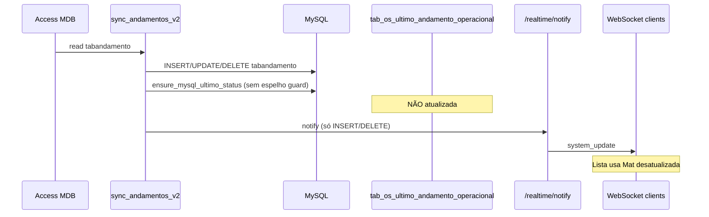
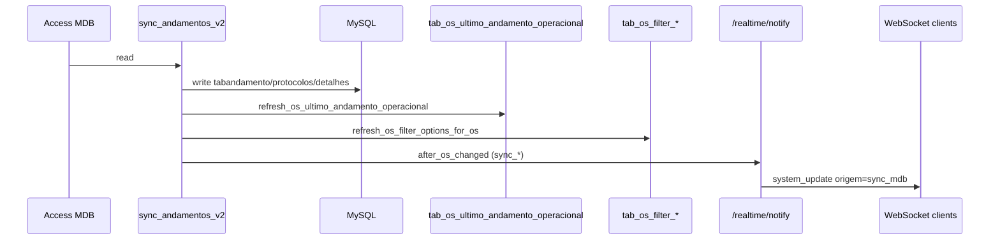

# Relatório de Auditoria — Sync MDB → MySQL vs SAGRA Web

**Data:** 2026-06-11  
**Escopo:** auditoria profunda de `sync_andamentos_v2.py` antes de adaptação para convivência com SAGRA Web em implantação.  
**Restrição:** alterações permitidas apenas no script de sync; backend/front permanecem intocados.

---

## Resumo executivo

O script `sync_andamentos_v2.py` replica unidirecionalmente `tabandamento`, `tabProtocolos` e `tabDetalhesServico` do Access para MySQL. A arquitetura atual do SAGRA Web depende de:

1. **`tab_os_ultimo_andamento_operacional`** — materializada usada por `GET /api/os/search` para situação/setor (exclui espelhos Sub OS).
2. **WebSocket `system_update`** — front refetch da lista/histórico em tempo real.
3. **`tab_os_filter_produtos` / `tab_os_filter_solicitantes`** — dropdowns de filtros.
4. **Replicação Web → MDB** via `mdb_writer.py` após commit MySQL.

**Veredito pré-correção:** compatível com ajustes obrigatórios. Há lacunas críticas que explicam lista desatualizada, WS sem UPDATE e risco de sobrescrita de `UltimoStatus` / campos Web-only.

---

## 1. Fluxos de escrita no MySQL

### 1.1 `insert_mysql(andamento, origem)`

| Aspecto | Detalhe |
|---------|---------|
| **Tabela** | `tabandamento` |
| **Campos** | INSERT completo: CodStatus, NroProtocoloLink, AnoProtocoloLink, SituacaoLink, SetorLink, Data, UltimoStatus, Observaçao, Ponto |
| **Pré-efeitos** | Se UltimoStatus=TRUE, zera UltimoStatus de todos os andamentos da mesma OS |
| **Quando** | `perform_sync()` — CodStatus novo no MDB e não em `deleted_andamentos` |
| **WebSocket** | Sim, via `SyncLogger.log('INSERT')` → `notify_api` |
| **Materializada** | **Não** |
| **Filtros aux.** | **Não** |
| **Risco** | Médio — notifica WS antes da materializada; `ensure_mysql_ultimo_status_from_mdb` roda depois mas sem refresh materializada |

### 1.2 `update_mysql(andamento, origem)`

| Aspecto | Detalhe |
|---------|---------|
| **Tabela** | `tabandamento` |
| **Campos** | UPDATE de todos os campos exceto PK |
| **Quando** | `perform_sync()` — CodStatus comum MDB/MySQL e `_andamentos_differ()` |
| **WebSocket** | **Não** — `log()` só notifica INSERT/DELETE |
| **Materializada** | **Não** |
| **Risco** | **Alto** — alteração de situação/setor no legado não aparece em tempo real na lista |

### 1.3 `delete_mysql(codstatus, andamento)`

| Aspecto | Detalhe |
|---------|---------|
| **Tabela** | `tabandamento`, `deleted_andamentos` (marca + remove após DELETE) |
| **Campos** | DELETE row; backup em `backup_andamentos` |
| **Quando** | Exclusão confirmada no MDB (`detect_and_register_deletions`) |
| **WebSocket** | Sim (INSERT/DELETE path) |
| **Materializada** | **Não** — recálculo de último andamento não atualiza `tab_os_ultimo_andamento_operacional` |
| **Risco** | **Alto** — lista pode mostrar situação antiga até refetch manual ou outro evento |

### 1.4 `ensure_mysql_ultimo_status_from_mdb(nro, ano)`

| Aspecto | Detalhe |
|---------|---------|
| **Tabela** | `tabandamento` |
| **Campos** | `UPDATE UltimoStatus = FALSE` em **toda** a OS; depois `TRUE` nos CodStatus marcados no MDB |
| **Quando** | Após insert/update/delete de andamento em `perform_sync()` |
| **WebSocket** | Não |
| **Materializada** | **Não** |
| **Risco** | **Crítico** — zera UltimoStatus inclusive em andamentos **só no MySQL** (Web criou, MDB ainda não replicou); não usa `MIRROR_EXCLUDE_CLAUSE` |

### 1.5 `sync_os_data_from_mdb(nro, ano, origem)`

| Aspecto | Detalhe |
|---------|---------|
| **Tabelas** | `tabProtocolos`, `tabDetalhesServico` |
| **Campos** | **Todas** as colunas do MDB (`SELECT *`), exceto PK no UPDATE |
| **Quando** | Antes de insert/update de andamento; também chamado pontualmente |
| **WebSocket** | **Não** |
| **Materializada** | Não (não afeta andamento diretamente) |
| **Filtros aux.** | **Não** |
| **Risco** | **Alto** — pode sobrescrever `email_pt_*`, colunas MySQL-only; sem allowlist |

### 1.6 `_sync_table_generic(...)`

| Aspecto | Detalhe |
|---------|---------|
| **Tabelas** | `tabProtocolos`, `tabDetalhesServico` |
| **Campos** | Todas as colunas MDB; `ignore_fields` parcial (email_pt_*, OrigemMDB, etc.) |
| **Quando** | Thread `_run_background_sync` a cada mudança de mtime do .mdb |
| **Escopo** | Ano >= 2024; OS < 5000 ou >= 5000 conforme banco |
| **WebSocket** | **Não** |
| **Risco** | **Alto** — varredura completa; pode sobrescrever campos Web; sem notify em mudança de solicitante/produto |

### 1.7 `_format_mysql_records(data_limite)`

| Aspecto | Detalhe |
|---------|---------|
| **Tabela** | `tabandamento` |
| **Campos** | Observaçao, Ponto |
| **Quando** | A cada 10 ciclos (`apply_formatting_to_recent_records`) |
| **Escopo** | `Data > now - 30 dias` |
| **WebSocket** | Não |
| **Risco** | Médio — altera registros do SAGRA Web; pode gerar divergência visual e re-trigger de `_andamentos_differ` se MDB não formatar igual |

### 1.8 Outras escritas MySQL

| Função | Tabela | Operação |
|--------|--------|----------|
| `SyncLogger._create_log_tables` | log_sync_andamentos, backup_andamentos, cache_andamentos_mdb, deleted_andamentos | DDL/INSERT log |
| `mark_as_deleted` / `_remove_from_deleted` | deleted_andamentos | INSERT/DELETE |
| `update_cache` | cache_andamentos_mdb | TRUNCATE + INSERT |
| `BackupManager.backup` | backup_andamentos | INSERT |

---

## 2. Escritas no MDB

| Função | Status | Chamada ativa? |
|--------|--------|----------------|
| `insert_mdb` | Implementada | **Não** — bloco MySQL→MDB comentado em `perform_sync()` |
| `delete_mdb` | Protegida | **Não** — retorna imediatamente com `DELETE_SKIPPED` |
| `update_ultimo_status` | Implementada | **Não** — só seria chamada no fluxo bidirecional comentado |
| `_format_mdb_records` | Implementada | **Não** — comentada em `apply_formatting_to_recent_records` |

**Conclusão:** fluxo principal é unidirecional MDB → MySQL. Risco de escrita involuntária no MDB é **baixo** desde que o bloco comentado não seja reativado. `update_ultimo_status` ainda contém escrita MDB e deve permanecer inacessível ou protegida por flag explícita.

---

## 3. Conflito com `tab_os_ultimo_andamento_operacional`

### Estado atual

O SAGRA Web mantém a materializada via `refresh_os_ultimo_andamento_operacional(nro, ano)` em `os_ultimo_andamento_service.py`, usando:

- `UltimoStatus = 1`
- `MIRROR_EXCLUDE_CLAUSE` — exclui `cod_status_espelho` de Sub OS

O sync **nunca** chama essa rotina (nem equivalente SQL).

### Impacto

`GET /api/os/search` usa `LEFT JOIN tab_os_ultimo_andamento_operacional`. Após sync de andamento, a lista continua com situação/setor antigos até:

- outra ação na API que chame `broadcast_os_system_update` (que refresca materializada), ou
- rebuild manual.

### Correção obrigatória

Após qualquer mudança em `tabandamento` ou `UltimoStatus` vinda do MDB:

1. `refresh_os_ultimo_andamento_operacional(nro, ano)` — SQL inline no script
2. **Depois** notificar WebSocket

Ordem: **MySQL → materializada → WebSocket**.

---

## 4. Conflito com WebSocket

### `notify_api()` atual

- Endpoint: `POST {api_base}/realtime/notify`
- Payload: `{ type, id, ano, action, origem: "sync_bot" }`
- Timeout: 0.5s, fire-and-forget, erros silenciados

### `/api/realtime/notify` vs `broadcast_os_system_update`

| Caminho | Refresh materializada? | WS broadcast? |
|---------|------------------------|---------------|
| `notify_api` → `/realtime/notify` | **Não** | Sim |
| `broadcast_os_system_update` (rotas API) | **Sim** | Sim |

### Matriz de notificação (pré-correção)

| Evento | Notifica? | Action |
|--------|-----------|--------|
| INSERT andamento | Sim | `sync_insert` |
| UPDATE andamento | **Não** | — |
| DELETE andamento | Sim | `sync_delete` |
| UltimoStatus replicado | **Não** | — |
| tabProtocolos alterado | **Não** | — |
| tabDetalhesServico alterado | **Não** | — |

### Correção esperada

Função central `after_os_changed(nro, ano, action)` com actions:

`sync_insert | sync_update | sync_delete | sync_protocol_update | sync_details_update`

`origem`: `sync_mdb`

---

## 5. Conflito com `UltimoStatus`

### Perguntas respondidas

| # | Pergunta | Resposta |
|---|----------|----------|
| 1 | O sistema novo já escreve no MDB ao criar andamento? | **Sim** — `mdb_writer.sync_andamento_from_mysql_to_mdb` após commit MySQL (`os_routes.py`) |
| 2 | Quanto tempo para MDB refletir? | Variável — retry com backoff (até ~5 tentativas, 2s base); MDB pode estar locked pelo Access legado |
| 3 | Sync pode rodar antes da escrita Web→MDB? | **Sim** — intervalo 0.2s; race real |
| 4 | Sync pode apagar/desmarcar andamento Web? | **Parcial** — `ensure_mysql_ultimo_status_from_mdb` zera **todos** UltimoStatus da OS baseado só no MDB; andamento Web-only perde marcação até MDB alinhar |
| 5 | Como identificar origem Web? | Não há campo `origem` em `tabandamento`; identificação indireta: CodStatus existe no MySQL mas não no MDB |

### Regras SAGRA Web (Sub OS)

- Espelhos têm `cod_status_espelho` em `tab_os_sub_os_andamento`
- Materializada **ignora** espelhos via `MIRROR_EXCLUDE_CLAUSE`
- `recalc_ultimo_status_operacional` nunca promove espelho
- Sync copia UltimoStatus do MDB **sem** excluir espelhos — risco se legado marcar espelho como último

### Travas propostas

1. `ensure_mysql_ultimo_status_from_mdb`: alterar **apenas** CodStatus presentes no MDB; não zerar andamentos só-MySQL
2. Refresh materializada sempre com `MIRROR_EXCLUDE_CLAUSE`
3. Manter sync unidirecional (não reativar MySQL→MDB no script)

---

## 6. Conflito com formatação Observaçao / Ponto

| Função | Comportamento |
|--------|---------------|
| `format_observacao` | Replica lógica VBA Access (prefixo hora, quebra de linha) |
| `format_ponto` | Insere ponto decimal em strings > 3 chars sem `.` |
| `apply_formatting_to_recent_records` | A cada 10 ciclos, últimos 30 dias no MySQL |
| `_andamentos_differ` | Formata MDB antes de comparar — evita loop parcial |

**Problemas:**

- SAGRA Web pode gravar formato diferente do VBA
- `_format_mysql_records` altera **todo** MySQL recente, inclusive registros Web
- Gera UPDATE silencioso sem WebSocket

**Proposta:** flag `SYNC_FORMAT_MYSQL_RECENT_RECORDS=false` (default off).

---

## 7. Conflito com tabProtocolos e tabDetalhesServico

### `sync_os_data_from_mdb`

- Copia **100%** das colunas MDB
- Sem allowlist, sem ignorelist
- Pode sobrescrever `email_pt_html`, `email_pt_versao`, `email_pt_data`

### `_sync_table_generic`

- `ignore_fields` parcial para protocolos
- Ainda copia todas as demais colunas MDB→MySQL
- Varredura `WHERE ano >= 2024` em ambos os lados

### Campos controlados pelo SAGRA Web (proteger)

| Tabela | Campos |
|--------|--------|
| tabProtocolos | `email_pt_html`, `email_pt_versao`, `email_pt_data`, `DataSincronizacao`, `OrigemMDB`, `HashRegistro` |
| tabDetalhesServico | `DataSincronizacao`, `OrigemMDB`, `HashRegistro` |

### Allowlist legado (espelho de `mdb_writer`)

**tabProtocolos:** CodigoRequisic, CategoriaLink, NomeUsuario, Titular, OrgInteressado, SiglaOrgao, GabSalaUsuario, Andar, Localizacao, RamalUsuario, DataEntrada, ProcessoSolicit, CSnro, EntregPrazoLink, EntregData, ContatoTrab (+ colunas cota dinâmicas se existirem)

**tabDetalhesServico:** Titulo, TipoPublicacaoLink, FormatoLink, MaquinaLink, Tiragem, Pags, FrenteVerso, ModelosArq, PapelLink, PapelDescricao, Cores, CoresDescricao, DescAcabamento, Observ, TiragemSolicitada, CotaTotal, MaterialFornecido, Fotolito, ModeloDobra, ProvaImpressa, InsumosFornecidos, ElemGrafBrasao, ElemGrafTimbre, ElemGrafArteGab, ElemGrafAssinatura (+ campos calculados)

---

## 8. Performance

| Parâmetro | Valor atual | Risco |
|-----------|-------------|-------|
| `intervalo_segundos` | 0.2 | 5 ciclos/s — leitura completa MDB OS + Papelaria + MySQL |
| `dias_monitoramento` | 15 | Janela de comparação |
| `read_mdb` / `read_mysql` | Full scan filtrado por Data + Ano>=2024 | Carga repetida em MDB em uso pelo legado |
| `update_cache` | TRUNCATE + INSERT a cada ciclo | Escrita MySQL desnecessária |
| `_run_background_sync` | mtime change → sync completo protocolos/detalhes | Pode disparar em qualquer gravação Access |
| `_sync_table_generic` | SELECT * ano>=2024 | Pesado em bases grandes |

**Propostas:**

- Lock de instância única (`GET_LOCK('sync_mdb_mysql', 0)`)
- Flag `SYNC_PROTOCOL_DETAILS_BACKGROUND` para desligar BG se necessário
- Logs de tempo por ciclo (inserts/updates/deletes/materializadas/notifies)
- Intervalo configurável via env (sugestão: 0.5–1.0s em produção)

---

## 9. Tabelas auxiliares de filtros

| Tabela | Fonte | Atualizada pelo sync? |
|--------|-------|----------------------|
| `tab_os_filter_produtos` | `tabDetalhesServico.TipoPublicacaoLink` | **Não** |
| `tab_os_filter_solicitantes` | `tabProtocolos.NomeUsuario` | **Não** |
| Anos (cache in-process API) | `tabProtocolos.AnoProtocolo` | **Não** (TTL 15min na API) |

Após sync de protocolo/detalhes, dropdowns podem ficar desatualizados até backfill (`rebuild_os_filter_options.py`).

**Proposta:** `refresh_os_filter_options_for_os(nro, ano)` — upsert incremental de produto/solicitante quando valores mudam.

---

## 10. Segurança contra múltiplas instâncias

| Mecanismo | Existe? |
|-----------|---------|
| Lock file | **Não** |
| MySQL advisory lock | **Não** |
| PID log | **Não** |
| Proteção duplicate insert | Sim — `COUNT(*)` antes de INSERT + catch 1062 |

Duas instâncias podem: duplicar notificações WS, competir em `update_cache` TRUNCATE, sobrecarregar MDB.

**Proposta:** `GET_LOCK('sync_mdb_mysql', 0)` no início de cada ciclo; logar PID; sair graciosamente se lock falhar.

---

## 11. Diagrama do fluxo atual (problemático)

## 12. Diagrama do fluxo alvo

---

## 13. Prioridade de correções

| Prioridade | Item |
|------------|------|
| P0 | `after_os_changed` + refresh materializada antes de WS |
| P0 | Notificar UPDATE e DELETE com materializada |
| P0 | Proteger UltimoStatus de andamentos só-MySQL |
| P1 | Allowlist protocolos/detalhes |
| P1 | Flag formatação off por default |
| P1 | Lock instância única |
| P2 | Refresh filtros incremental |
| P2 | Métricas de performance por ciclo |
| P2 | `MIRROR_EXCLUDE` no refresh materializada |
